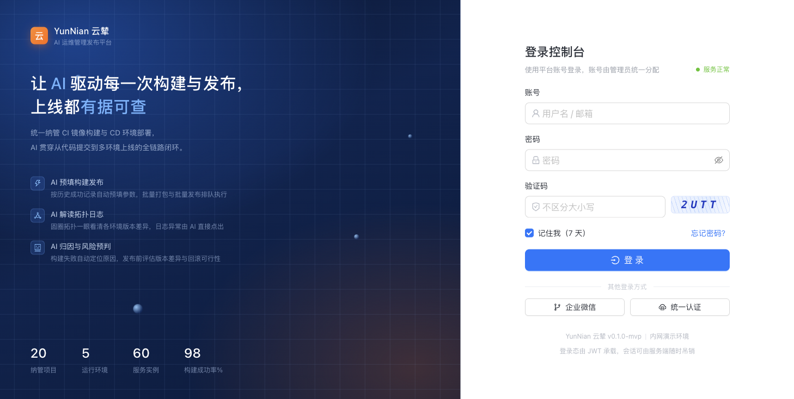
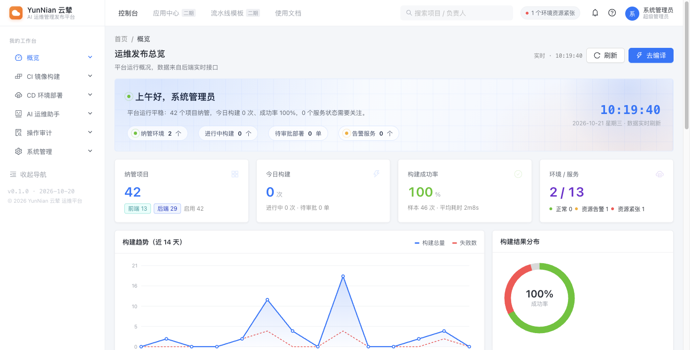
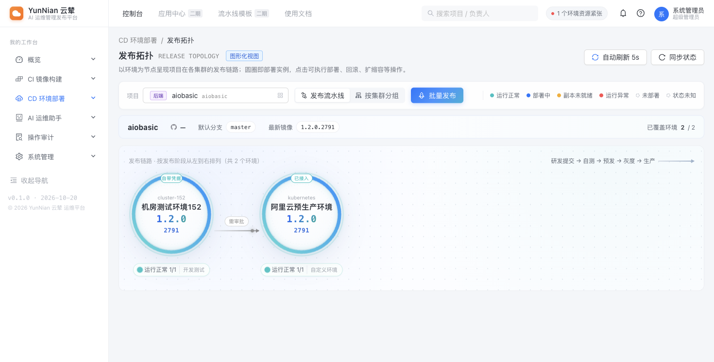
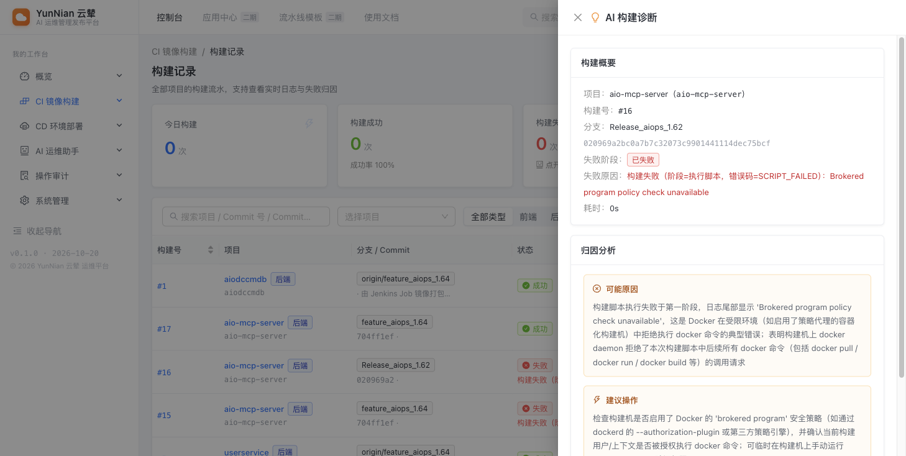
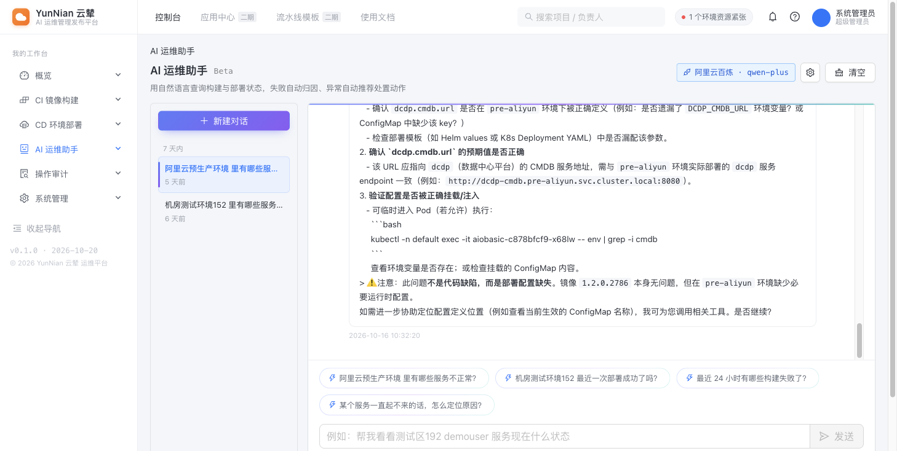
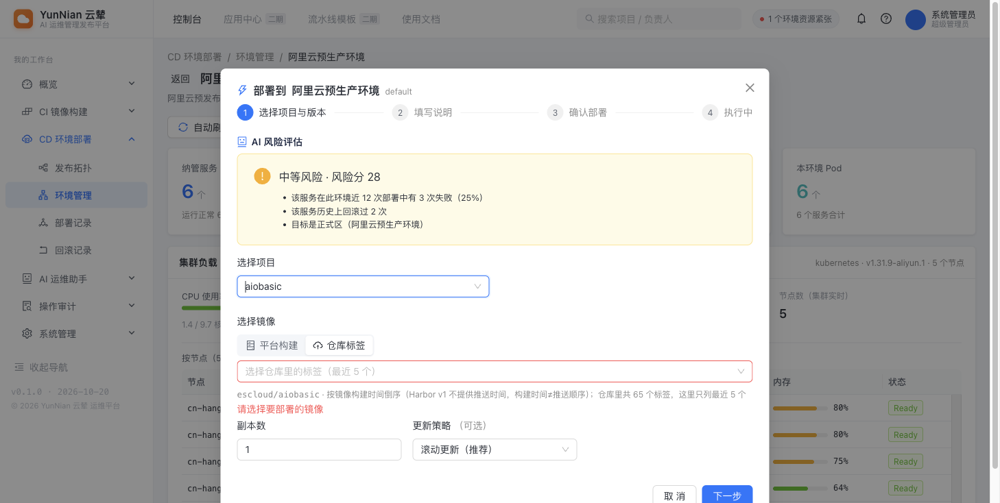

# YunNian 云辇 · AI 运维管理发布平台

> 内部 CI/CD 管理平台 —— 镜像构建 + 环境部署 + 发布拓扑，把"构建产物运到各环境"这条链路收进一个控制台。

自建构建**真跑 docker**（构建成功 = 仓库里真有镜像，digest 从 push 输出读回）、写集群的动作**统一收敛到 AppRelease CR**（直改 Deployment 会被 operator 秒拉回）、AI 助手**只能查不能改**（工具清单里没有任何写接口）。后端 Go 1.26 单栈，前端 React 18 + Ant Design 5，**一个进程**对外服务。

> **名称**：`YunNian` 对应中文 **云辇**（「辇」为载运之器，取"把构建产物运到各环境"之意）。

[](https://go.dev/)
[](https://react.dev/)
[](https://www.mysql.com/)
[](https://redis.io/)
[](https://www.docker.com/)
[](https://opensource.org/licenses/MIT)

* * *

## 目录

- [界面预览](#界面预览)
- [AI 能做什么](#ai-能做什么)
- [功能特性](#功能特性)
- [安装与部署](#安装与部署)
  - [一键部署（推荐）](#一键部署推荐)
  - [源码部署](#源码部署)
  - [环境要求](#环境要求)
  - [本地开发](#本地开发)
- [工作原理](#工作原理)
- [安全机制](#安全机制)
- [项目结构](#项目结构)
- [常见问题](#常见问题)
- [许可证](#许可证)

* * *

## 界面预览

**登录页** —— 图形验证码 + 登录失败限流锁定，不枚举账号是否存在。



**控制台概览** —— 平台运行总览、构建趋势与环境健康；顶部直达编排入口。



**发布拓扑** —— 以环境为节点呈现各项目的发布链路，一眼看出哪个环境缺哪个服务。



> AI 相关的三张图在下一节「[AI 能做什么](#ai-能做什么)」。

* * *

## AI 能做什么

平台里 AI 不是"聊天框挂件"，而是接在这条链路的三个具体位置上。
**全部只读** —— 8 个工具里没有任何一个会改变集群或平台状态（见 [安全机制](#安全机制)）。

### ① 构建失败自动归因

构建挂了，点「AI 诊断」直接给原因和下一步，不用自己去翻几百行日志：



模型读的是**完整构建日志 + 失败阶段 + 错误码**，输出结构固定为「可能原因 → 建议操作」，
末尾标注模型通道与置信度。上图的结论是 `Brokered program policy check unavailable` ——
构建机的 docker daemon 拒绝了脚本里的 docker 调用，而不是代码写错了。

### ② 用一句话查集群状态

不用记「哪个页面、哪个筛选、哪个字段」，直接问：



它**自己调工具取数**（`list_environments` → `get_service_status` → `diagnose_service`），
而不是靠"上下文里没有就说没有"。上图回答里给出了缺失的环境变量名、需要检查的
ConfigMap、以及可直接执行的 `kubectl` 命令。

工具调用过程在界面上可见（「查询过程 · N 次」），**查不到时如实说查不到**，
不会把"没取到数据"说成"一切正常"。

### ③ 部署前风险评分

建单前算 0–100 分，把"这次会不会出事"变成可讨论的数字：



评分是**纯计算**（不是模型拍的），五个因子各自可追溯：
近 N 次部署失败率、历史回滚次数、是否重复发布同一版本、目标是否正式区、同环境是否有在飞部署。
上图 28 分来自：25% 失败率 + 回滚过 2 次 + 目标是正式区。

三档（低 / 中 / 高）**都会显示** —— 低风险也明确写出来，
因为"什么都没有"和"没做这个功能"在用户眼里长得一样。

* * *

* * *

## 功能特性

### 镜像构建（CI）

| 功能 | 说明 |
| --- | --- |
| **自建构建** | 平台进程内真跑 `git clone → docker build → docker push`；digest 从 push 输出逐字读回，架构从 `docker image inspect` 读回 |
| **自定义脚本** | 项目自己写 shell，平台只注入 `YUNNIAN_*` 变量与 Git 凭据；默认脚本覆盖 clone / 编译 / 打包 / 推送全流程 |
| **Jenkins 接入** | 复用公司已有 Jenkins：平台负责触发、拉日志、同步状态；产物版本靠解析日志里的 `docker push` 得出，**读不到就留空，不猜版本号** |
| **实时日志** | SSE 推送，支持断线续传（`Last-Event-ID`）；可取消、可重试 |
| **失败真因落库** | 构建/部署的失败原因写进 `error_message` 列，平台重启后仍然可查（不是只留在易失的日志流里） |
| **AI 归因** | 模型优先、规则兜底；给出的是"缺哪个配置 / 哪个探针没过"，不是一串错误码 |
| **镜像台账** | 镜像版本页可按项目/环境检索；另有「Harbor 仓库」视角直接读仓库真实 tag（含非平台推送的） |

### 环境部署（CD）

| 功能 | 说明 |
| --- | --- |
| **发布拓扑** | 以环境为节点呈现项目分布，一眼看出哪个环境缺哪个服务、哪个服务起不来 |
| **批量发布** | 一次发多个服务（同一环境）；**编排在后端**，关掉浏览器后面的单照样创建 |
| **审批流** | 需要审批的环境发单后停在 `pending_approval`，审批通过才开始滚动 |
| **部署前风险评分** | 建单前算 0–100 分：历史失败率、回滚次数、重复发布、正式区、同环境在飞部署；**纯计算**，每分都能对上账 |
| **环境可见范围** | 角色可配"能看哪几台 / 能部署哪几台"；未授权的环境在列表里直接**看不到**，直连接口 403，AI 也问不出来 |
| **回滚** | 手工回滚到指定历史版本；回滚目标必须校验"属于本项目" |
| **失败不回滚** | 部署失败**不自动回滚**（回滚本身也是一次发版，同样会失败）；恢复交给人走手工链路 |
| **Pod 日志** | 按服务实例实时拉 Pod 日志，SSE 推送 |

### 平台治理

| 功能 | 说明 |
| --- | --- |
| **用户与角色** | 5 个内置角色、31 个权限点，权限点支持 `env:*` / `deploy:test,staging` 通配与枚举 |
| **团队主数据** | 项目归属团队；用户数据权限按团队反查（不再是自由字符串） |
| **通知** | 邮件（SMTP）与钉钉（加签）**真投递**；订阅矩阵生效；结果回写 `last_sent_at` / `fail_count` / `last_error` |
| **AI 运维助手** | 8 个**只读**工具自查集群；模型能自己取数，不靠"上下文里没有"就答查不到 |
| **模型通道** | 密钥 AES-256-GCM 加密存储、脱敏回显；可设平台默认通道 |
| **操作审计** | 自动埋点 + 多条件检索 + 异步导出 |
| **Webhook** | GitLab / GitHub 共享密钥 + HMAC 校验；**留空则回调直接 403**，不允许无签名触发构建 |
| **集群接入** | kubeconfig 导入、加密落库、只读探测、命名空间列表 |

* * *

## 安装与部署

### 一键部署（推荐）

一条命令拉起 **应用 + MySQL 8 + Redis 7**：

```bash
git clone https://github.com/2777484478/yunnian.git
cd yunnian

# 三个密钥必须先生成 —— 没有默认值，缺一个就起不来
export YUNNIAN_JWT_SECRET="$(openssl rand -base64 48)"
export YUNNIAN_MASTER_KEY="$(openssl rand -base64 32)"
export MYSQL_ROOT_PASSWORD="$(openssl rand -base64 24)"

docker compose up -d --build
docker compose logs -f app
```

等 `app` 变成 `healthy`，浏览器打开 `http://<服务器IP>:8080`。

| 项 | 值 |
| --- | --- |
| 默认账号 | `admin` |
| 默认密码 | `changeme` —— **首次登录后立刻改** |
| 端口 | `8080`（改 `YUNNIAN_PORT` 换） |

> ⚠️ 密钥**不要写进 `docker-compose.yml` 并提交**。放在宿主的 `.env` 里更省事：
> `cp .env.example .env` → 填好 → `docker compose up -d`（compose 会自动读同目录的 `.env`）。

> ⚠️ `app` 容器挂载了宿主机的 `/var/run/docker.sock` —— 平台的"自建构建"就是靠它调用宿主机的 docker daemon。**这等于把宿主机的 root 权限交给了平台容器**，请只在可信环境这么做。

> ⚠️ **首次启动会自动写入演示数据**（`database.seed: true`）：20 个示例项目、5 个环境、
> 若干构建/部署记录，以及 **`admin` / `ops` / `guest` + 20 个开发账号，密码全部是 `changeme`**。
> 这是为了让界面一打开就有内容可看，但**生产环境必须处理**：
>
> 1. 登录后立刻改掉 `admin` 的密码（「系统设置 › 个人设置」）
> 2. 停用或删除用不上的演示账号（「系统管理 › 用户」，支持删除）
> 3. 删掉示例项目（「CI › 项目管理」，或用下面的 SQL 批量软删）
>
> ```sql
> -- 先确认要删的是哪些（演示项目的 owner 是"张伟/李静/王强…"这批演示账号）
> SELECT project_key, name FROM project WHERE deleted_at IS NULL;
> -- 确认无误后软删全部项目与示例环境
> UPDATE project SET deleted_at = NOW() WHERE deleted_at IS NULL;
> UPDATE environment SET deleted_at = NOW() WHERE deleted_at IS NULL;
> ```
>
> 已有数据时 `seed` 会整段跳过，**不会覆盖**你后来建的东西。
> 想彻底不灌演示数据：`YUNNIAN_DB_SEED=false`，但那样库里**一个账号都没有**，
> 需要自己写库建管理员 —— 一般不建议新装时关掉。

停服务 / 清数据：

```bash
docker compose down      # 停服务，保留数据卷
docker compose down -v   # 连数据一起清掉
```

### 源码部署

不想用容器、或要改代码：

```bash
git clone https://github.com/2777484478/yunnian.git
cd yunnian

# ① 依赖（MySQL 8 + Redis 7）
docker compose -f docker-compose.dev.yml up -d

# ② 后端 —— ⚠️ 新 clone 的仓库**没有 config.yaml**（被 .gitignore 忽略），要先从模板复制
cd backend
cp configs/config.yaml.example configs/config.yaml

# 然后把 configs/config.yaml 里的 database.dsn 改成上面 docker-compose.dev.yml 那套账号：
#   dsn: "yunnian:changeme@tcp(127.0.0.1:3306)/yunnian?charset=utf8mb4&parseTime=true&loc=Local"
# 模板里写的是 "user:password@tcp(...)" 占位符，不改会报 Access denied。
# （也可以不改文件，直接用环境变量覆盖：YUNNIAN_DB_DSN="yunnian:changeme@tcp(...)"）

go build -o bin/yunnian-server ./cmd/server
YUNNIAN_ENV=prod \
YUNNIAN_JWT_SECRET="$(openssl rand -base64 48)" \
YUNNIAN_MASTER_KEY="$(openssl rand -base64 32)" \
./bin/yunnian-server

# ③ 前端（另开一个终端）
cd frontend
npm ci
npm run dev        # 开发模式，:5173，代理到后端 :8080
```

生产环境也可以只编译前端产物、由后端托管（单进程）：

```bash
cd frontend && npm ci && npm run build     # 产物在 frontend/dist
cd ../backend && go build -o bin/yunnian-server ./cmd/server
# 配置里 app.staticDir 指向 ../frontend/dist，后端会一并托管
```

### 环境要求

| 组件 | 版本 | 说明 |
| --- | --- | --- |
| Go | ≥ 1.26 | 仅编译时需要 |
| Node.js | ≥ 20 | 仅编译前端时需要 |
| MySQL | 8.0 | `utf8mb4`；`autoMigrate` 会自动建表 |
| Redis | 7 | **可关**：关掉后日志流 / 分布式锁 / 失败计数自动退回进程内实现 |
| Docker | ≥ 20.10 | 「自建构建」需要（`runner.executor=docker`） |

单机即可，**不需要独立 Runner 节点**。

### 本地开发

```bash
# 依赖
docker compose -f docker-compose.dev.yml up -d

# 后端
cd backend && go run ./cmd/server

# 前端
cd frontend && npm run dev
```

冒烟测试（只读模式，不会真的发版）：

```bash
cd backend && ./scripts/smoke.sh
```

> 部署 / 回滚段**默认不跑** —— 要跑得显式 `SMOKE_WRITE=1`，且动手前会先打印"改谁、改成什么"。
> 集群写入只打靶 `default/nginx-demo`。

* * *

## 工作原理

### 构建链路

```
① 领任务        队列取出构建单（并发上限来自「系统管理 › 运行参数」）
② clone         按项目凭据拉代码（脚本项目走自定义脚本）
③ 编译          可选：独立编译容器（编译镜像可配）
④ docker build  本机即构建机，真跑 docker
⑤ push          推到 Harbor，digest 从 push 输出读回
⑥ 登记          写 image_record（digest / 大小 / 架构）
```

### 部署链路

```
① 预检          镜像是否存在（只拒 404 tag，其余放行）
② 风险评分      历史失败率 / 回滚 / 正式区 / 并发 → 0–100 分
③ 建单          命中审批环境 → 停在 pending_approval
④ 下发          写 AppRelease CR，**不直改 Deployment**
⑤ 等待          轮询 CR 状态；K8s 报 ProgressDeadlineExceeded → ROLLOUT_STUCK
⑥ 收尾          落终态 + 失败真因 + 通知
```

### 写集群为什么统一走 CR

平台直接改 Deployment 会被 operator **秒拉回**（operator 以 CR 为准）。
所以所有写操作都收敛到 `AppRelease` CR：

- HPA 托管的负载**拒绝扩缩容**（改了也白改）
- 部署失败**不回滚**：回滚本身也是一次发版，它同样会失败，届时集群被改到第三个状态
- 「平台库的值不是真相」：现在是什么**必须读集群**；读不到就如实说读不到，**不许回退库值**

* * *

## 安全机制

| 面 | 做法 |
| --- | --- |
| 密钥存储 | JWT 密钥、加密主密钥、模型通道密钥走环境变量注入；`app.env=prod` 时检测到开发密钥**直接拒绝启动** |
| 凭证加密 | kubeconfig、Git 凭据、模型密钥用 AES-256-GCM 加密落库，接口只回"有没有"，不回明文 |
| 权限模型 | 31 个权限点 + `env:*` / `deploy:test,staging` 通配与枚举；环境可见范围可按环境收敛 |
| AI 只读 | 工具清单里**只有 8 个读工具**，没有写接口 —— 模型说"我帮你重启了"也没有东西可调 |
| Webhook | 共享密钥 + HMAC 校验；**留空则回调接口直接 403**（免鉴权的 webhook 等于给公网开了构建触发器） |
| 审计 | 变更类操作自动埋点，记录操作人、对象、前后值 |
| 部署失败 | 不自动回滚，但会在日志流里明说"工作负载停在本次变更后的镜像上" |

> ⚠️ **仓库里不含生产密钥**，但 `backend/configs/config.yaml` 是本地开发用的示例配置，
> 其中邮箱授权码等属于**历史遗留**。换环境部署时一律用环境变量覆盖，不要沿用。

* * *

## 项目结构

```text
yunnian/
├── backend/                  Go 单栈后端
│   ├── cmd/server/            入口（装配、启动补偿、运行时设置）
│   ├── internal/
│   │   ├── api/               HTTP 层（路由、中间件、handler）
│   │   ├── service/           业务层（构建、部署、用户、AI、通知…）
│   │   ├── integration/       下游通道（Harbor / K8s / Jenkins / Git）
│   │   ├── model/             GORM 模型
│   │   ├── store/             迁移、种子、配置读写
│   │   └── config/            配置加载（yaml → 环境变量）
│   ├── configs/               配置模板
│   └── scripts/               冒烟测试、启动脚本
├── frontend/                 React 18 + TS + Vite + AntD 5
│   ├── src/
│   │   ├── api/               接口封装
│   │   ├── components/        通用组件
│   │   ├── layouts/           布局与导航
│   │   ├── pages/             业务页面（CI / CD / 系统管理）
│   │   └── types/             与后端 DTO 对齐的类型
│   └── vite.config.ts         构建配置（产物为单文件）
├── docs/                     设计文档（架构 / DDL / API / 前端 / 时序 / 排期）
├── deploy/                   辅助镜像（编译环境镜像）
├── Dockerfile                生产镜像（多阶段）
├── docker-compose.yml        一体化部署
└── docker-compose.dev.yml    仅本地依赖（MySQL / Redis）
```

* * *

## 常见问题

**部署后打不开页面 / 502**
先看 `docker compose logs app`。`app` 依赖 MySQL 与 Redis 健康后才启动，
用 `docker compose ps` 确认三个服务都是 `healthy`。

**启动报"你还在用开发密钥"**
`YUNNIAN_ENV=prod` 时平台会拒绝使用仓库里的示例密钥。注入随机值：

```bash
openssl rand -base64 48   # → YUNNIAN_JWT_SECRET
openssl rand -base64 32   # → YUNNIAN_MASTER_KEY
```

**"自建构建"报 docker 相关错误**
平台需要能调用 docker daemon。容器部署时已挂载 `/var/run/docker.sock`；
源码部署时确认当前用户能执行 `docker ps`。

**Harbor 读不到 digest / 构建日志里刷超时**
平台的 Harbor 走 `/v2/`（OCI Distribution 协议），Core 管理接口与它通常同端口。
先确认 `integration.harbor.registry` 与 `baseUrl` 指向**同一个仓库** —— 平台只核对同仓库的镜像。

⚠️ 配置模板里 `integration.harbor.enabled` 默认是 **`true`**、地址是 `registry.example.com`
（示例值）。**没有真实 Harbor 时请把它改成 `false`**，否则每次构建都会去连一个不存在的域名，
日志里会刷一串连接超时 —— 构建本身不受影响，但很难看出"这只是示例配置"。

**部署总是 `ROLLOUT_STUCK`（滚动更新卡死）**
K8s 在 `progressDeadlineSeconds`（默认 600s）到点就判卡死，而镜像拉得慢时 Pod
常常在 600s **之后**才起来。平台已在失败后继续观察并标出「失败后已就绪」，
但根因要改工作负载上的 `progressDeadlineSeconds`。

**改了 Go 代码但行为没变**
`go build ./...` **不产二进制**。要 `go build -o bin/yunnian-server ./cmd/server`
再重启 —— 跑旧二进制是假绿的最常见来源。

**Redis 能关掉吗**
能。关掉后日志流、部署锁、失败计数自动退回进程内实现（单机够用，多实例部署时不要关）。

* * *

## 许可证

[MIT](./LICENSE) © 2026 Digiwin

仓库**不含生产密钥**。部署前请按上面的说明注入自己的密钥。

> MIT 覆盖的是**本仓库的代码**，不改变你与模型服务商、Harbor、GitLab 等
> 第三方之间的协议 —— 那些仍按各自的条款走。
