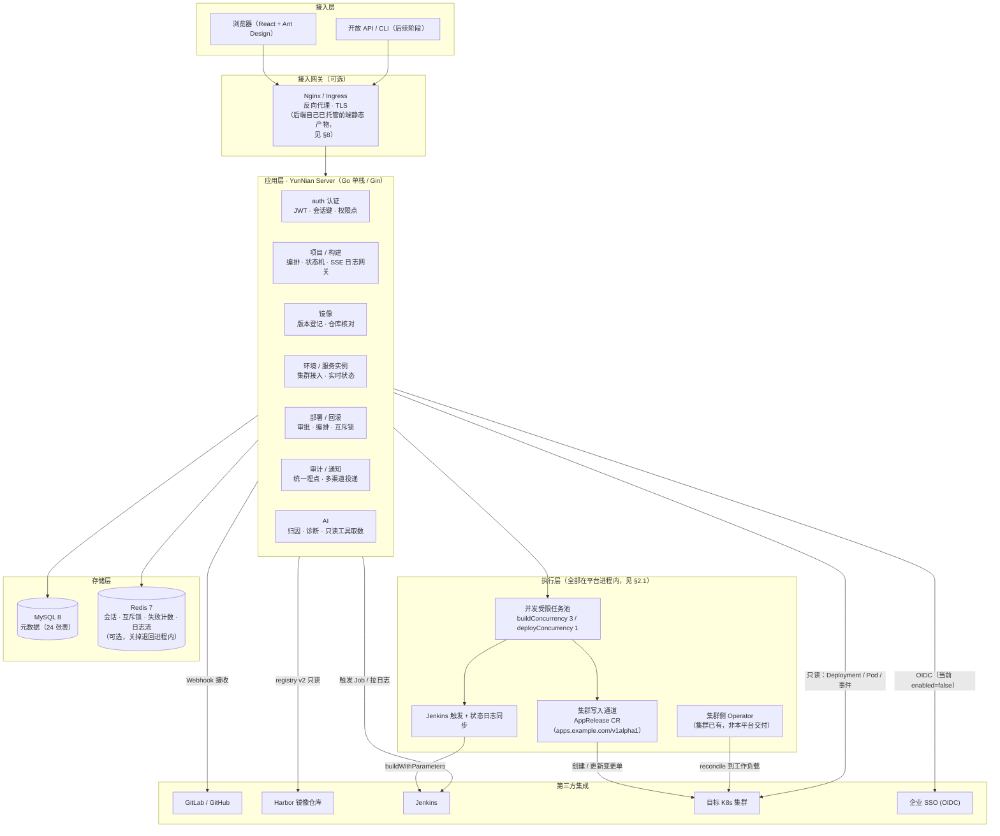
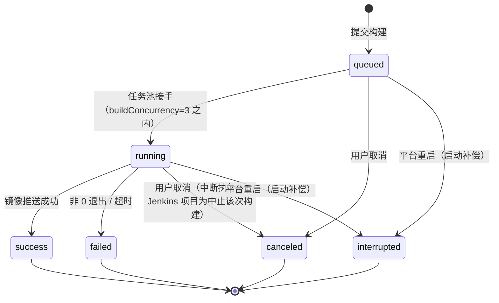
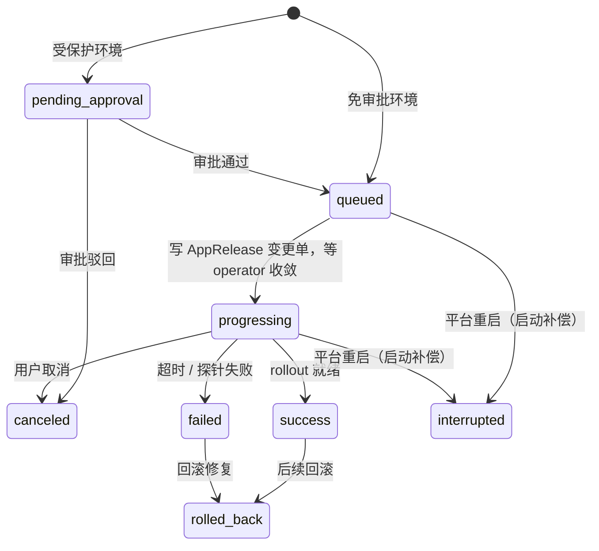

# YunNian 云辇 · 整体架构设计（第一阶段 MVP）

> **状态：已按实现回填（2026-10-10）。** 一期的前后端均已实现并实测通过，
> 本文原稿里被推翻的部分（独立 Runner、NestJS 技术栈）已在 §2.1 / §3 / §3.1 / §4 逐处标注，
> **保留原方案是为了留下"为什么改"的记录**，不是待办。
> 实现现状与逐条未落地项见 [`../backend/README.md`](../backend/README.md)；
> 阶段排期见 [`06-MVP排期建议.md`](./06-MVP排期建议.md)。

> 适用范围：第一阶段 —— **CI 镜像构建管理** + **CD 环境部署管理**。
> 文档版本：v0.1 · 2026-09-22（2026-10-10 按实现修订）

---

## 1. 目标与边界

### 1.1 第一阶段要解决的问题

公司现有前端 10 个、后端 10 个，共 **20 个项目**，发布流程分散在 GitLab + Jenkins + 手工 kubectl 之间，存在四个痛点：

| 痛点 | 现状 | 平台化后的目标 |
| --- | --- | --- |
| 构建入口分散 | Jenkins Job 命名随意，谁都能改 | 统一在平台配置构建方式，参数模板化 |
| 镜像版本不可追溯 | 不知道线上跑的是哪个 commit | 镜像 Tag 规则统一，image_record 全量留档 |
| 部署靠人肉 kubectl | 命令散落在聊天记录里 | 环境 → 服务 → 一键部署，参数与审批受控 |
| 回滚不敢做 | 不知道该回滚到哪个版本 | 历史版本列表 + 一键回滚 + 审计留痕 |

### 1.2 明确不做（第一阶段）

- 不做多集群蓝绿/金丝雀自动流量调度（仅保留灰度区手动发布）
- 不做微服务拓扑调用链、APM 监控（只做日志）
- 不做流水线可视化编排（DSL/画布），只提供「固定流水线 + 参数」
- AI 能力只做 **读侧**（查询、归因、建议），不做自动执行

---

## 2. 总体架构



### 2.1 执行层：最终**不做**自建 Runner（原设计被推翻，2026-10-10 拍板）

> **这一节记录一次被推翻的架构决策。** 原稿的结论是「方案 B：平台编排 + 独立 Runner 拉取任务」，
> 实际落地走的是 **方案 C：复用已有 Jenkins**。

原设计的三方案对照（保留，供理解"为什么当时想自建"）：

| 方案 | 优点 | 缺点 | 原结论 |
| --- | --- | --- | --- |
| A. 平台进程内直接执行 `docker build` | 实现最快，无额外组件 | 构建会把平台自身 CPU / 内存吃满；并发互相干扰；平台重启丢任务 | ❌ 只适合 Demo |
| B. 平台编排 + 独立 Runner 拉取任务 | 平台与构建资源隔离；Runner 可水平扩容；Runner 挂了不影响平台 | 需要多一个进程和任务队列 | ✅ **原计划采用** |
| C. 全部委托 Jenkins | 复用现有 Jenkins | 平台沦为 Jenkins 的皮，日志 / 状态要二次拉取 | ⚠️ 仅作 `buildMethod=jenkins` 的兼容路径 |

**实际采用 C，理由**：公司已有 Jenkins。自建 Runner 等于把
「构建机怎么维护、怎么扩容、怎么清磁盘、怎么轮转凭证」变成平台自己的问题 ——
对单人维护来说这是失控的开销。平台改为把项目和 Jenkins Job 绑起来
（`project.build_method=jenkins` + `project.jenkins_job`），负责触发、拉日志、同步状态。

**代价（必须知情）**：Jenkins **没有**"这次构建产出了什么"的接口，产物版本只能逐行解析
日志里的 `docker push`（`integration.ParsePushedImage`）。解析器**只认确定证据**，
读不到就**留空**，不猜版本号 —— 一个猜出来的版本号会让人真的去仓库找它。

**为什么仍保留方案 A 的形态**：`runner.mode=inline` 时平台确实在进程内执行
（`buildConcurrency: 3` / `deployConcurrency: 1` 的并发受限任务池），
但这是**本地 / 演示形态，不是生产形态**：进程重启时正在跑的任务会丢，
所以启动补偿会把它们标成 `interrupted`（见 §4.1）。
`runner.mode=agent`（独立 Runner 领任务）**已于 2026-10-10 决定不做** —— 平台保持**单体单机**
（构建 / 发布 / 部署只用一台机器），Runner Agent 的两条收益（资源隔离、水平扩容）在单机下都不存在，
而代价（多一个进程、多一套协议、多一个管理页、掉线收口）是实打实的。
配成 agent 时**构建会明确失败**（`integration.UnavailableBuilder` → `RUNNER_UNAVAILABLE`），
**不是**"退回本地照跑"：退回等于给出一条假成功记录。`model/runner.go` 保留为无引用的预留。

**集群写入同样没有自建执行器，而是走集群里已有的 CR**：平台创建 / 更新
`AppRelease`（`apps.example.com/v1alpha1`）变更单，由集群侧的 operator reconcile 到工作负载。
两条被实测逼出来的纪律：**直改 Deployment 会被 operator 秒拉回**；
**HPA 托管的负载拒绝扩缩容**。所以"写"只有一个入口，读则统一走 client-go。

### 2.2 日志推送技术选型：SSE 而非 WebSocket

| 维度 | SSE | WebSocket |
| --- | --- | --- |
| 方向 | 服务端 → 客户端单向（**正好符合日志场景**） | 双向 |
| 协议 | 纯 HTTP，Nginx/网关零改造，天然兼容公司代理 | 需要 Upgrade 头透传，部分企业代理会掐断 |
| 重连 | 浏览器 `EventSource` 自动重连 + `Last-Event-ID` 断点续传 | 需自己实现心跳与重连 |
| 鉴权 | 走标准 Header / Cookie | 握手阶段鉴权较别扭 |

**结论**：构建日志、部署日志、AI 流式回答全部用 **SSE**，并约定：

```
GET /api/v1/builds/{id}/logs/stream
Accept: text/event-stream
Last-Event-ID: 128          # 断线重连时从该序号后续传

event: log
id: 129
data: {"seq":129,"ts":"2026-09-22T16:01:03+08:00","level":"info","line":"Step 5/9 : COPY . ."}

event: status
data: {"status":"success","duration":96,"image":"harbor.../user-web:master-a91f3c2-202609221600"}

event: end
data: {"reason":"finished"}
```

实现细节（**2026-10-10 按实现回填**）：日志写入 `logstream.Stream` 抽象，默认是**进程内**的
`MemStream`（Redis 可选：`redis.enabled=false` 时日志流 / 分布式锁 / 失败计数一起退回进程内实现）。
SSE 按 `Last-Event-ID` 从该序号起续传；任务结束后写入终态，SSE 收到后发 `end` 事件并断开。

> ⚠️ **进程内日志流是易失的**（带 TTL，平台重启即丢）。原稿写的
> `Redis Stream: yn:build:{id}:log` + `XREAD BLOCK` **没有实现** —— 实现的是上面这套抽象。
> 由此推出一条必须守住的纪律：**失败的原因不能只活在日志里**。
> 这就是 `build_record.error_message` / `deploy_record.error_message` 存在的原因（见 §7 审计一行），
> 别再让人"去日志里找原因"。

---

## 3. 技术选型（2026-10-10 按实现回填）

| 层 | 选型 | 实际版本 | 理由 / 备注 |
| --- | --- | --- | --- |
| 前端框架 | React + TypeScript | 18.3 / 5.6 | 生态最全；类型与后端 DTO 对齐 |
| UI 组件库 | Ant Design | 5.x | 与阿里云控制台观感一致，表格 / 表单能力强 |
| 前端构建 | Vite | 5.x | 冷启动快；`build` 产出单文件，便于发给同事评审 |
| 路由 | React Router | 6.x | **`HashRouter`**（后端托管静态资源，无需服务端 rewrite 规则） |
| 前端数据层 | 自研 `src/api/` + hooks | — | 统一响应体、拦截器（token / 错误 toast）、`useEnvResources` 等实时取数 hook。~~TanStack Query + Zustand~~ **未引入** |
| 后端语言 / 框架 | **Go + Gin** | **Go 1.26** | 单栈、单二进制（见 §3.1） |
| ORM | GORM v2 | — | `SingularTable`（表名用单数，与 `docs/02` 的 DDL 及手写 JOIN 三方一致） |
| 数据库 | MySQL | 8.0 | 公司已有 DBA 运维体系 |
| 缓存 | Redis（go-redis v9） | 7.x | 会话键、部署互斥锁、登录失败计数、日志流。**可选**：`redis.enabled=false` 时全部退回进程内实现，本地零依赖可跑 |
| 任务队列 | **自研并发受限任务池**（`internal/queue`） | — | ~~BullMQ / asynq~~ **未引入**。进程内、有并发上限：队列满 → `42900`，重复提交 → 状态冲突 |
| 镜像仓库 | Harbor | v2.10+ | **只读**，走 `/v2/`（OCI Distribution），不用 Core 管理接口 —— 原因见 §6 |
| K8s 客户端 | **client-go**（`k8s.io/client-go v0.31.5`） | — | 只读探索（Deployment / Pod / 事件 / 日志）+ 经 `dynamic client` 写 `AppRelease` CR |
| 权限 | **自研权限点**（`internal/auth` 通配匹配） | — | ~~Casbin~~ **未引入**。权限点形如 `deploy:test`；环境级权限点在 handler 内动态拼出，路由表上声明不了 |
| 邮件 | 标准库 `net/smtp` + `crypto/tls` | — | 不引第三方库；`smtps`(465) 与 `starttls`(587) 分开处理 |
| 大模型 | 自研 OpenAI 兼容客户端（`internal/llm`） | — | 流式 + 原生 `tool_calls`；能力探测工具 `cmd/llmprobe` |
| 对象存储 | — | — | ~~MinIO~~ **未引入**：构建日志落 `build_log` 表（`maxLogBytes` 50MB 截断），当前无归档需求 |
| 平台自身部署 | 单进程 + 托管前端静态产物 | — | 本地 `scripts/start-local.py` 起后台；生产 systemd / supervisord / k8s Deployment |

### 3.1 后端为什么是 Go 单栈（原「NestJS vs Spring Boot」已作废）

原 §3.1 在 Spring Boot 与 NestJS 之间做选择，前提是「有一支 2 人后端团队、公司可能已有 Java 中台」。
实际是 **1 名个人开发者 + 单仓双端**，那套权衡不成立。最终定的是 **Go 单栈**：

| 维度 | 结论 |
| --- | --- |
| 交付形态 | **一个二进制**跑起全部能力（含托管前端 `dist`），没有 Node / JVM 基建要维护（进程管理、探针、运行时版本） |
| 与 K8s 生态的贴合 | `client-go` 与 `dynamic client` 是官方一等公民：Pod 日志流、事件、CR 读写都是一等 API。这是本平台最重的一块依赖，也是选型里权重最大的一项 |
| SSE | 标准库直接写 `text/event-stream` 并 `Flush()`，没有框架层要绕 |
| 本机环境 | Go 已就绪；不需要 JDK 17（本机只有 JDK 8） |
| 放弃的 | 前后端同语言共享类型的便利。代价用 `frontend/src/types/index.ts` 作为 DTO 对齐基准兜底 |

> API 契约、表结构、时序与语言无关，本文其余章节照旧有效。

---

## 4. 模块划分与职责（2026-10-10 按实现回填）

原稿这里是 NestJS 的 `modules/` 布局 + 一个 `runner/` 独立进程。实际目录如下
（`runner/` **不存在**，见 §2.1；平台的 crate 级职责仍与原设计一一对应）：

```
backend/
├── cmd/server/            入口：配置 → 日志 → DB → 缓存 → 下游 → 加密 → 队列 → 服务 → HTTP
├── cmd/llmprobe/          诊断工具：探测模型通道是否支持 tools / role:"tool" / 流式 tool_calls
├── configs/config.yaml    配置（内置默认 → 文件 → 环境变量 YUNNIAN_ 三层覆盖）
└── internal/
    ├── api/               HTTP 层：路由表 + handler + SSE 写出（**不写业务判断**）
    │                      ← 原 auth / project / build / image / environment /
    │                        deploy / service / rollback / audit / notify / ai 各模块的 handler
    ├── service/           业务层：auth / ci / cd / system / jenkins / notify / ai + DTO
    ├── store/             迁移（AutoMigrate）、命名策略、种子数据、配置持久化
    ├── model/             GORM 模型（24 张表）
    ├── auth/              JWT 签发解析 + 权限点通配匹配
    ├── cache/             Redis 封装：会话键、失败计数、分布式锁、日志流
    ├── logstream/         日志流接口 + 进程内实现（SSE 的数据底座）
    ├── queue/             并发受限任务池 + 部署互斥锁接口
    ├── integration/       下游抽象：Harbor / GitLab / K8s / Jenkins / AppRelease（均含 local 实现）
    ├── crypto/            AES-256-GCM 凭证加密
    ├── llm/               OpenAI 兼容大模型客户端（流式 + 原生 tool_calls）
    ├── middleware/        TraceID / Recovery / AccessLog / CORS / Auth / 权限
    ├── httpx/ errs/       统一响应体、分页、错误码
    └── config/            配置加载与校验
```

**分层纪律**：handler 只绑定入参、组装 Caller、写响应；业务规则、事务与审计**全部在 `service`**，
且 **`service` 不依赖 gin**（因此可以脱离 HTTP 层单测）。

### 4.1 状态机（必须严格，否则并发下会出乱子）

**构建状态机**



**部署状态机**



**`interrupted`（已中断）为什么不能并进 `failed` / `canceled`**

成因是**平台进程消失**，不是构建或发布本身出错，也不是有人叫停。合进 `failed` 会让人去查
「这次发布哪里错了」（其实没有错），合进 `canceled` 会把「平台重启」谎报成「有人点了取消」。

写入时机：`CIService.ReconcileInterrupted` / `CDService.ReconcileInterrupted`，由
`cmd/server/main.go` 在**开始对外服务之前**调用（20s 超时，失败只告警不阻断启动）。
判据只用「非终态」，不看心跳 —— 重启这一刻**任何**还没结束的构建/部署都已经不可能再继续了，
它依赖的执行实体随进程消失了。

两条边界：

- **`pending_approval` 绝不算中断**：它是合法的长期等待态（审批人可能明天才点），既没有执行实体、
  也不依赖进程存活。把它标成中断等于**凭空替用户撤单**。
- **耗时（`duration_sec`）必须显式写「开始 → `updated_at`」**，不能让 DTO 用
  `finished_at - started_at` 兜底：补偿写的 `finished_at` 是「扫描时刻」，平台若挂了 8 小时才重启，
  一个只跑了 30 秒的构建会显示「耗时 8 小时」。从未开跑（`started_at` 为空）的则不写，
  由前端显示「—」。
- 回滚记录跟着部署单一起收拢，但范围限定 `deploy_id IN (本次被打断的部署单)`，
  **不按 `status` 全量扫**（成因不同，不该由启动补偿替它下结论）。

> **并发控制**：同一 `environment + service` 同时只允许一个 `progressing` 部署，
> 用 Redis 分布式锁 `SET yn:lock:deploy:{env}:{svc} {token} NX PX 1800000` 实现；拿不到锁直接拒绝并提示「该服务有部署在进行中」。

---

## 5. 权限模型（RBAC）

三层模型，兼顾「按角色」和「按项目/环境」的授权粒度：

```
用户 ──(N:N)── 角色 ──(N:N)── 权限点
   │
   └──(N:N)── 项目成员（owner / maintainer / developer / reporter）
   └──(N:N)── 环境授权（readonly / deployer / approver）
```

| 角色 | 项目权限 | 环境权限 | 典型能力 |
| --- | --- | --- | --- |
| admin | 全部 | 全部 | 用户/角色/系统配置、删除项目 |
| ops | 全部只读 | 全部 | 部署/回滚/扩缩容/重启、审批正式区 |
| dev | 自己负责的项目可写 | test / staging 可部署 | 改构建配置、触发构建、测试区部署 |
| qa | 只读 | test 可部署 | 测试区部署与重启 |
| readonly | 只读 | 只读 | 查看构建历史、日志、审计 |

**权限点命名**：`{资源}:{动作}[:{范围}]`，如 `project:write:own`、`deploy:test,staging`、`audit:*`。
后端在路由表上声明权限点，由权限中间件校验（`internal/middleware` + `internal/auth` 的通配匹配）；
**环境级权限点在 handler 内动态拼出**（`deploy:test` / `deploy:prod` 这类按环境名拼，路由表上声明不了）。
前端用 `<RequirePerm codes={['deploy:read']}>` 包住路由做入口控制 ——
**前端隐藏仅为体验，后端必须再校验一次**。

> ⚠️ **一个已知的待定项**：AI 的只读工具**没有**按环境收敛权限 ——
> 有 `ai:query` 的用户可以通过工具读到**任意环境（含 prod）**的集群实时值。
> 详见 `docs/03` §12 与 `06-MVP排期建议.md` §2.1。

---

## 6. 第三方集成设计

| 系统 | 集成方式 | 关键点 |
| --- | --- | --- |
| GitLab | ① REST API（列分支、取 commit）② Webhook（push → 自动触发构建） | Webhook 需校验 `X-Gitlab-Token`；推送事件按 `project_key + branch` 匹配是否自动构建 |
| GitHub | REST API + Webhook（`X-Hub-Signature-256` HMAC 校验） | 与 GitLab 抽象成同一个 `GitProvider` 接口 |
| Harbor | **Docker Registry v2（`/v2/`，OCI Distribution）**，不是 Core 管理接口 | 平台对仓库**只读**：拿构建日志里解析出的 `repo:tag` 去核对，回填 `image_record` 的 digest / 大小 / 架构。不用 `/api/v2.0` 的原因：实测内网 Harbor 只暴露 registry 组件（`:5000`），管理接口在 `:5000`/`:443`/`:80` 上全是 404。public 项目匿名即可读，private 项目才需要 robot 账号（只给 pull）。镜像清理（要写权限）尚未做，做之前必须先查 `image_record.deployed_envs` 防误删 |
| Jenkins | REST + 远程触发 `POST /job/{job}/buildWithParameters` | **这是本平台的主力构建通道**（见 §2.1）。平台按 `project.jenkins_job` 绑定关系触发、轮询队列项拿构建号、拉日志、同步状态。三个踩过的坑：**CSRF crumb 按会话加盐**（客户端必须带 cookie jar，单独请求 crumb 再 POST 会 403）；**Job 不存在要单独识别**（否则被归成 502，让人去查"Jenkins 是不是挂了"）；**Jenkins 自报的 `rootUrl` 是内网 IP**（响应里的链接点不开，一律改写成配置的 baseUrl）。产物版本只能从日志解析（§2.1） |
| Kubernetes | **`client-go v0.31.5`**：只读探索（Deployment / Pod / 事件 / 日志）；`dynamic client` 写 `AppRelease` CR | 集群凭据有两种来源：**环境自带 kubeconfig**（加密落库）或**平台集群表**（`k8s_cluster`）。⚠️ `environment.kubeconfig_credential_id = NULL` **不代表**发版不写集群 —— 会回退查平台集群表。Namespace 级 ServiceAccount 最小权限 |
| SSO | OIDC Authorization Code + PKCE | 首次登录按 email 匹配 / 创建本地用户；角色仍由平台内管理。**当前 `oidc.enabled=false`**：未接入时 `/auth/oidc/*` 返回明确的「未接入」错误，前端据此隐藏入口 —— **不留"点了没反应"的入口** |

**凭证管理**：所有 Token / kubeconfig 存 `secret_credential` 表（模型通道密钥另存 `ai_model_config`），
字段用 **AES-256-GCM** 加密，密钥来自环境变量 `YUNNIAN_MASTER_KEY`（生产环境接 KMS）。
接口回显一律脱敏（`••••••`），**仅平台进程在运行时解密** —— 不把集群凭据交给模型，
AI 要读集群就通过平台自己那套客户端执行只读工具（见 §4 的 `ai` 模块）。

---

## 7. 非功能设计（2026-10-10 按实现回填）

| 项 | 设计（★ = 与实现一致；✎ = 已按实现修正） |
| --- | --- |
| 幂等 ★ | 构建 / 部署提交带 `idempotencyKey`（请求体字段），重复提交复用同一条记录。⚠️ 只解决"重复提交"，**不解决"平台重启后重新入队"** —— 后者未做 |
| 超时 ✎ | `runner.buildTimeout` **30 分钟**、`runner.deployTimeout` **15 分钟**（**全局配置，不按项目覆盖**，`configs/config.yaml` 可改）；K8s 操作另有 60 秒级超时 |
| 重试 ✎ | 构建失败**不自动重试**（避免污染镜像仓库）；~~Runner 心跳丢失 3 次~~ → **没有心跳机制**。真实的收口是**启动补偿**：进程重启后把非终态任务标成 `interrupted`（见 §4.1），反向的按幂等键重新入队**未做** |
| 限流 ✎ | **登录失败**：同账号 5 次 / 5 分钟（`auth.loginFailLimit` / `loginFailWindow`）。~~单用户 5 分钟 10 次构建~~ **没有按用户的令牌桶**；构建 / 部署受**队列并发上限**约束（`buildConcurrency: 3` / `deployConcurrency: 1`），队列满时返回 `42900` 并说明"构建队列已满，请稍后重试" |
| 日志容量 ✎ | 单次构建日志上限 **50 MB**（`runner.maxLogBytes`），超出截断，落 `build_log` 表；~~MinIO 归档 / Redis Stream 保留 20k 行~~ **都没有**。⚠️ 日志流是进程内易失的，所以失败原因另有落点（`*_record.error_message`） |
| 审计 ★ | 所有写操作自动写 `audit_log`，含变更前后内容 |
| 可观测 ★ | `/healthz`（存活）、`/readyz`（依赖就绪）、`/metrics`（Prometheus） |
| 备份 | MySQL 每日全量 + binlog；`secret_credential` 单独加密备份 |
| 高可用 | 一期单机（可接受停机窗口）；二期 Server 双副本 + Redis Sentinel。⚠️ 单进程形态下，**平台重启会中断正在执行的构建 / 部署**（这就是 `interrupted` 状态存在的原因） |

---

## 8. 平台自身的部署拓扑（2026-10-10 按实现回填）

**一期实际形态：一个进程。** 后端 `:8080` 同时对外提供 API 与前端静态产物
（`npm run build` 之后直接开 `http://127.0.0.1:8080` 就是完整平台）。
没有独立 Nginx、没有 Runner 容器、没有 MinIO。

```
┌────────────── 1 台机器（生产：systemd / supervisord / k8s Deployment）──────────────┐
│                                                                                    │
│  yunnian-server  :8080                                                             │
│    ├── /api/v1/*        RESTful 接口 + SSE 实时流                                   │
│    ├── /healthz        存活探针                                                     │
│    ├── /readyz         依赖就绪（MySQL / Redis）                                     │
│    ├── /metrics        Prometheus                                                   │
│    └── /*              frontend/dist（前端静态产物，SPA 单入口）                      │
│                                                                                    │
│  MySQL 8   :3306   元数据（24 张表，首次启动 AutoMigrate + 灌种子）                   │
│  Redis 7   :6379   会话键 / 部署互斥锁 / 登录失败计数 / 日志流                        │
│                    ⚠️ 可选：redis.enabled=false 时以上全部退回进程内实现              │
└────────────────────────────────────────────────────────────────────────────────────┘
```

**本地开发**：`docker compose -f docker-compose.dev.yml up -d` 起 MySQL + Redis，
再用 `python3 backend/scripts/start-local.py` 把后端脱离终端起在后台
（**不要用 `命令 &`** —— 交互式 shell 退出会发 SIGHUP 把后端一起带走）。

**若要挂到 Nginx / Ingress 后面**：把 `/` 全部反代到 `:8080` 即可（后端自己托管前端），
**不需要**再单独配一份静态资源服务。生产环境必须注入
`YUNNIAN_ENV=prod` + `YUNNIAN_JWT_SECRET` + `YUNNIAN_MASTER_KEY` + `YUNNIAN_DB_DSN`，
否则 `Validate` 会拒绝以 prod 启动（用内置开发密钥会被识别出来）。

---

## 9. 主要风险与规避（2026-10-10 按实现回填）

| 风险 | 影响 | 规避措施 |
| --- | --- | --- |
| **单进程形态：平台重启会中断正在执行的构建 / 部署**（原「Runner 挂 `docker.sock`」已随 Runner 方案作废） | 任务停在非终态，用户以为还在跑 | 启动补偿在**开始对外服务之前**把非终态任务标成 `interrupted` —— 独立状态码，不并进 `failed`（那会让人去查"哪里错了"）也不并进 `canceled`（那是把重启谎报成"有人取消"）。⚠️ 反向的"按幂等键重新入队"**未做** |
| **Jenkins 是外部依赖，且平台问不出"这次产出了什么"** | 产物版本登记错，`image_record` 出现查不到的镜像 | `ParsePushedImage` **只认确定证据**（`docker push` 行；容忍 `set -x` 的 `+ ` 前缀；变量未展开 / 不带 tag / 冒号是端口 / digest 推送一律不认），读不到就留空。登记前剥掉 `scheme://`（否则切出 `registry='https:'` 这种残骸记录） |
| Harbor 磁盘被历史镜像撑爆 | 平台不可用 | 保留策略 + 清理任务 + 磁盘水位告警。⚠️ 平台**只改自己的记录，不真删仓库 tag** —— 做真删之前必须先查 `image_record.deployed_envs` 防误删正在用的版本 |
| kubeconfig 泄露 | 生产被改 | AES-256-GCM 加密存储 + Namespace 级 SA 最小权限 + 正式区操作二次审批 + **写集群只有一个出口（AppRelease CR）** |
| 部署并发覆盖 | 线上状态错乱 | Redis 锁 `yn:lock:deploy:{env}:{svc}`（拿不到锁直接拒绝并说明"该服务有部署在进行中"）+ 状态机拒绝非法跃迁 |
| Webhook 风暴（批量推 tag） | 任务池拥塞 | **幂等键带 commit**（`push:{projectKey}:{branch}:{commitId}`，同一提交重发只建一个构建）+ **两级分支白名单**（项目级自动构建范围 + 全局 `AllowedBranches`）+ 队列满时回 `42900` 背压 |
| 日志流易失（进程内 + TTL） | 排查时"现场已经没了" | 失败原因落库 `*_record.error_message`（**7 个写点**，含"渠道拒收"和"启动补偿"）；部署失败时把**集群侧原始证据**（容器状态 / 退出码 / 崩溃前那一轮日志 / Pod 事件）写进日志流，因为 AI 归因可能降级、**证据不会** |
| AI 建议误导 | 误操作 | AI **只读是结构性保证**（工具注册表里没有 apply / scale / restart / rollback，模型说"我帮你重启了"也没有东西可调）；建议须由人点击确认后走正常 REST（带权限与审计）；来源如实标注 `model` / `rule` 并分叉措辞 |
