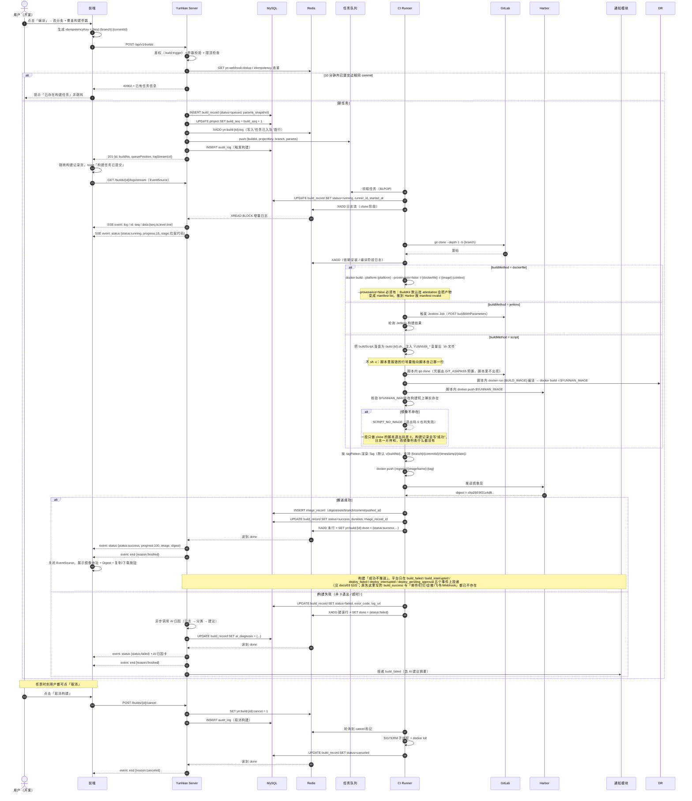
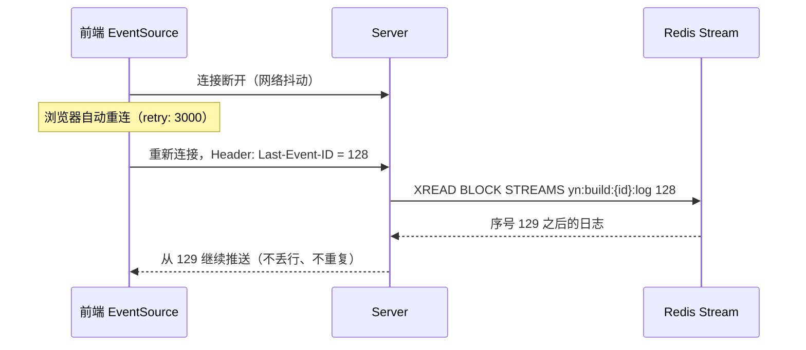
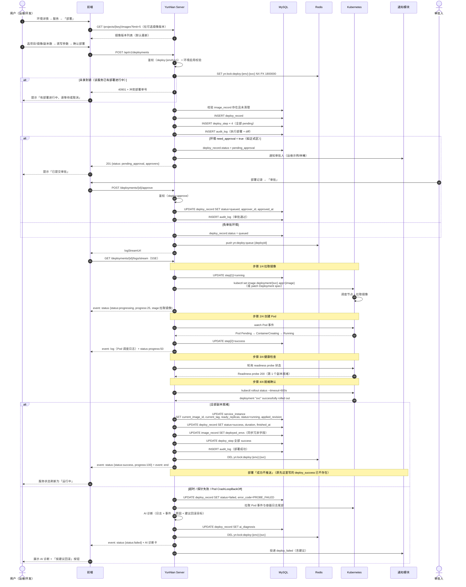
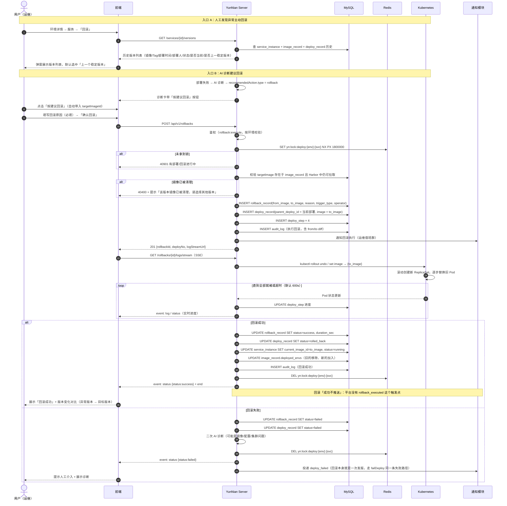
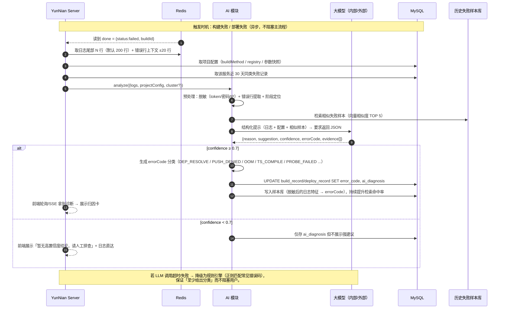
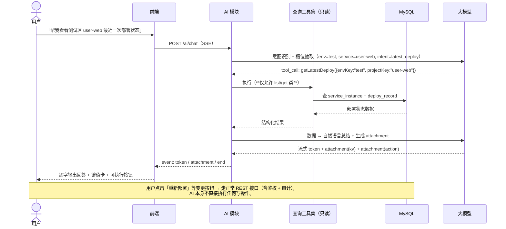
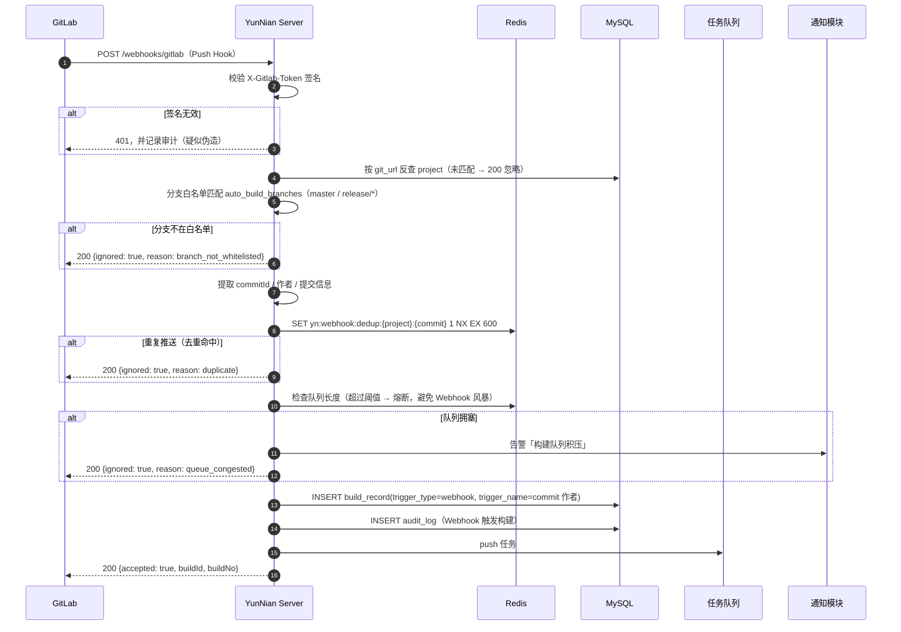

# YunNian 云辇 · 关键流程时序图

> 三个核心流程：**CI 构建**、**CD 部署（含审批）**、**版本回滚**；
> 另附 **AI 失败归因** 与 **Webhook 自动构建** 两个辅助流程。

---

## 1. 一键编译（CI 构建 + 实时日志）

### 1.1 断线续传

---

## 2. 部署流程（含正式区审批）

### 2.1 回滚与部署的关系

> 回滚在实现上是**部署的特殊形态**：以历史 `image_record` 为目标镜像创建新的 `deploy_record`，
> 并在 `rollback_record` 中记录 `from_image` / `to_image` / `reason`。
> 这样部署状态机、日志通道、审计埋点全部复用，无需第二套逻辑。

---

## 3. 版本回滚流程

---

## 4. AI 失败归因流程

### 4.1 AI 自然语言查询（只读）

---

## 5. Webhook 自动构建流程

---

## 6. 时序图中的关键约束汇总

| 约束 | 实现位置 |
| --- | --- |
| 构建幂等（10 分钟内同 commit 不重复构建） | `POST /builds` + Redis `yn:webhook:dedup` |
| 部署互斥（同环境同服务串行） | Redis `yn:lock:deploy:{env}:{svc}`，TTL 30 分钟 |
| 日志不丢不重（SSE 断线续传） | Redis Stream + `Last-Event-ID` |
| 状态机拒绝非法跃迁 | 服务层统一 `assertTransition(from, to)` |
| 破坏性操作必留审计 | Interceptor 拦 `POST/PUT/PATCH/DELETE` 自动写 `audit_log` |
| 受保护环境二次确认 | `environment.need_approval` + `deploy:approve` 权限点 |
| 镜像清理前校验引用 | `image_record.deployed_envs` + `service_instance.current_image_id` |
| AI 只读 | AI 模块白名单工具集，变更操作返回 action 卡片由用户触发 |
| 上游故障降级 | LLM 超时 → 规则引擎；Harbor 不可达 → 构建失败并明确提示上游不可用（50200） |
